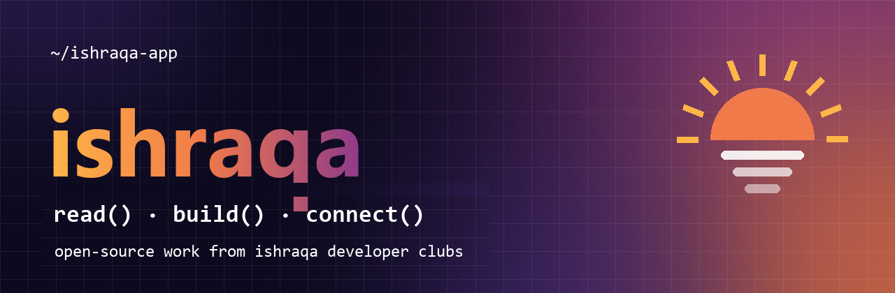
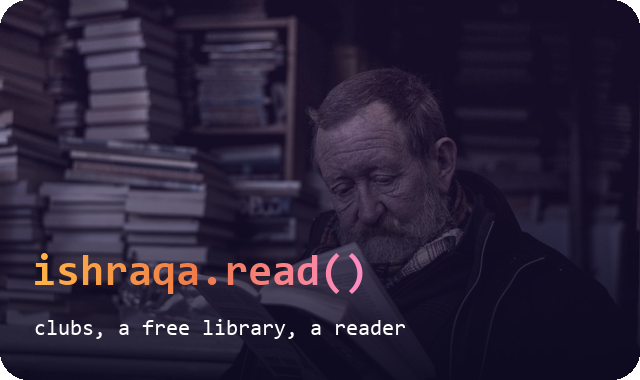
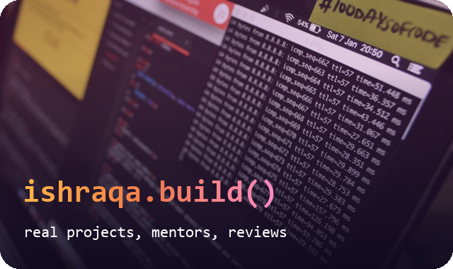
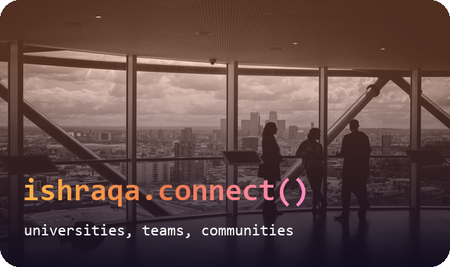

<p align="center"></p>

<p align="center">
<b>A crucible of knowledge, a space for reading, and a horizon from the memory of the past to the possibilities of the future.</b><br>
<a href="https://ishraqa.app">ishraqa.app</a> · <a href="https://play.google.com/store/apps/details?id=com.taeziz.ishraqa">Google Play</a> · <a href="https://www.npmjs.com/package/ishraqa">npm</a>
</p>

<table>
<tr>
<td width="33%"></td>
<td width="33%"></td>
<td width="33%"></td>
</tr>
</table>

```js
// We don't want to add more knowledge to a world already full of it.
// We want to help people manage it, share it, create it — and turn it into impact.
```

### projects/

| repo | what it is |
|---|---|
| [`ishraqa-cli`](https://github.com/ishraqa-app/ishraqa-cli) | Ishraqa Daily in your terminal · `npx ishraqa` |
| [`club-template`](https://github.com/ishraqa-app/club-template) | the starting point of every developers club repository |

### clubs.how()

```text
1  join a developers club in the app
2  your club gets its own repository here, automatically
3  pick an issue → branch → pull request → a mentor reviews
4  ship it, demo it, and it carries the badge below
```

[](https://ishraqa.app)

<p align="center"><a href="https://ishraqa.app"></a></p>
